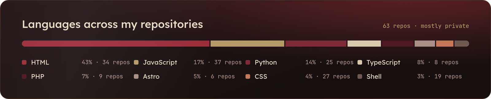
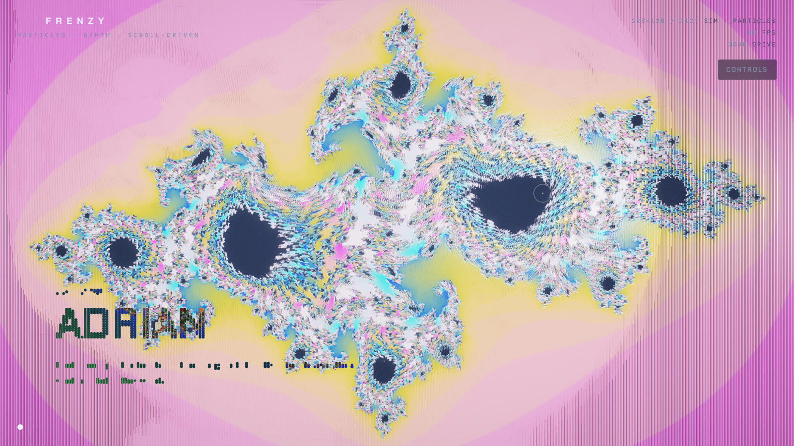
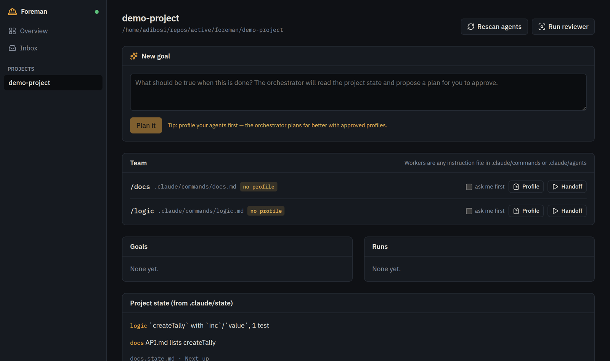
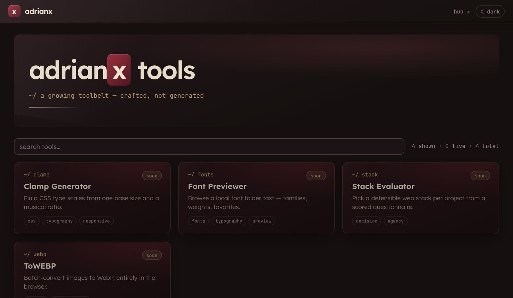
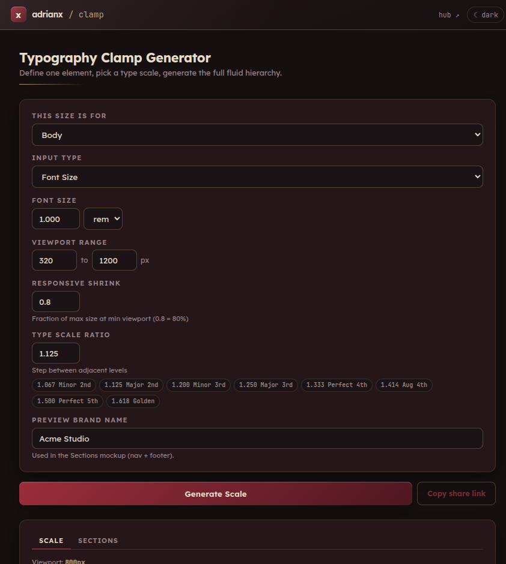
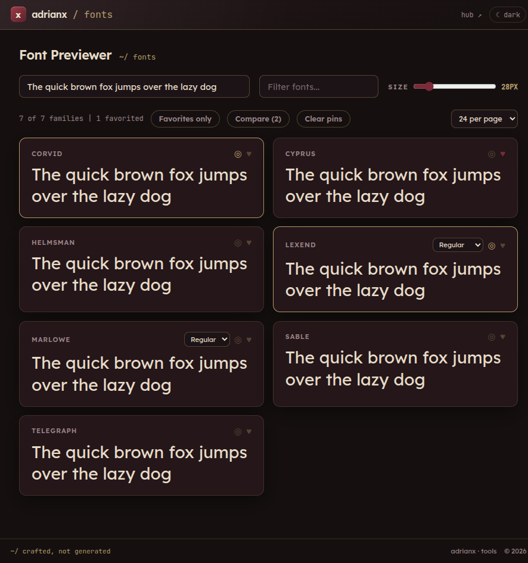
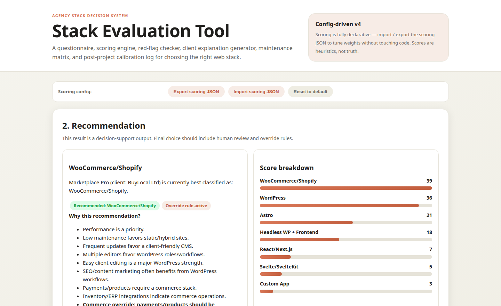

  

<table>
  <tr>
    <td width="52%" valign="top">
      <h3> Hi, I'm Adrian</h3>
      

        I'm <strong>Adrian Xhanaj</strong> (Αντριάν Τζανάι), a <strong>Creative Developer and AI consultant</strong>. I build websites, small tools,
        and the AI workflows that tie them together.
      

      

        My rule is <em>systems for the self, tools for the others</em>. I build systems to run my own
        work first, and the ones that hold up become tools other people can use.
      

      

        AI is the reason I got into this field, hence the handle. Today most of my work is
        teaching AI agents to do real jobs <strong>safely</strong>: with clear plans, approval points,
        and a human who says yes before anything important happens.
      

    </td>
    <td width="48%" align="center" valign="top">
      
    </td>
  </tr>
</table>

---

  <h2> Tech Stack</h2>

  <h4>Web</h4>
  

  <h4>Back end, CMS & data</h4>
  

  <h4>Creative</h4>
  

  <h4>Tools & platforms</h4>
  

  

    
    
    
    
    
    
  

  <picture>
    <source media="(prefers-color-scheme: dark)" srcset="images/snake/snake-dark.svg" />
    
  </picture>

---

##  What I Bring

<table>
  <tr>
    <td width="56" align="center"></td>
    <td><strong>AI agents that ask first</strong></td>
    <td>Designed a method for running several Claude agents on one project: a planner that never writes code, workers with written roles, shared state files, and structured handoffs. Then I turned it into a tool (Foreman, below).</td>
  </tr>
  <tr>
    <td width="56" align="center"></td>
    <td><strong>Marketing, SEO & analytics with AI</strong></td>
    <td>Built a knowledge base and playbook around Google's tools (Analytics 4, Tag Manager, Search Console, PageSpeed and Lighthouse) connected to Claude through MCP. With it I run real SEO audits, tracking setups, keyword research and performance reports, end to end.</td>
  </tr>
  <tr>
    <td width="56" align="center"></td>
    <td><strong>AI consulting</strong></td>
    <td>Help people and teams bring AI into their daily work: which tasks to hand to an agent, how to write instructions it can follow, and where a human must stay in the loop.</td>
  </tr>
  <tr>
    <td width="56" align="center"></td>
    <td><strong>Automating daily work</strong></td>
    <td>Turn repeated work into proper workflows: written conventions, reusable building blocks, and documentation that both people and AI agents follow, so routine work runs the same way every time and nothing lives only in someone's head.</td>
  </tr>
  <tr>
    <td width="56" align="center"></td>
    <td><strong>WordPress security plugin</strong></td>
    <td>A plugin that needs only WP admin access: file-integrity checks, change detection, alerts, and a tamper-evident logbook. Built in response to the wave of AI-driven WordPress attacks.</td>
  </tr>
  <tr>
    <td width="56" align="center"></td>
    <td><strong>Security freak</strong></td>
    <td>I like to know exactly what my machines are doing. I keep a Wireshark toolkit with monitoring profiles, rolling captures and a one-command network health check, and I test new apps to see whether they phone home before I trust them.</td>
  </tr>
  <tr>
    <td width="56" align="center"></td>
    <td><strong>60+ tools and experiments</strong></td>
    <td>Small tools that remove repeated work: file renamers and sorters, PDF extraction, image-to-WebP batches, WooCommerce product fixes, a policies generator, bookmarking, and more.</td>
  </tr>
</table>

---

##  Featured Projects

<table>
  <tr>
    <td width="50%" valign="top">
      
      <h3>FRENZY</h3>
      
A GPU art piece: images dissolve into about a million particles that react to your mouse and spring back into place when you stop. Scrolling flies the camera through depth-stacked image layers.

      
 WebGL2, GLSL, GSAP ScrollTrigger, vanilla JS (no build step)

    </td>
    <td width="50%" valign="top">
      
      <h3>Foreman</h3>
      
A local manager for teams of Claude Code agents. Goals become plans, workers run in parallel in their own git worktrees and stream live, and nothing important happens without your approval.

      
 TypeScript, Fastify, SQLite, Claude Agent SDK, React 19, Vite, Tailwind

    </td>
  </tr>
</table>

###  adrianx · tools

> `~/ a growing toolbelt — crafted, not generated`

A family of small web tools that share one brand. The design tokens, fonts and shell are hosted once, so a single change restyles every tool.

<table>
  <tr>
    <td colspan="3"></td>
  </tr>
  <tr>
    <td width="33%" valign="top">
      
      <h4>Clamp Generator</h4>
      
A fluid CSS type scale from one base size and a musical ratio, with copy-ready <code>clamp()</code> values.

    </td>
    <td width="33%" valign="top">
      
      <h4>Font Previewer</h4>
      
Browse a local font folder fast: families, weights, favourites, and side-by-side comparisons.

    </td>
    <td width="33%" valign="top">
      
      <h4>Stack Evaluator</h4>
      
Pick a defensible web stack per project from a scored questionnaire, with red flags and the reasoning behind each result.

    </td>
  </tr>
</table>

---

##  Background

Before code, I worked **behind a camera and in the edit**: filming, video editing, and posters in Photoshop, Premiere and After Effects. That is where the *creative* half of my title comes from. I studied **Informatics Engineering**, and I speak **Greek, Albanian and English**.

---

  Most of my work lives in private repositories, so this page is the window into it.

